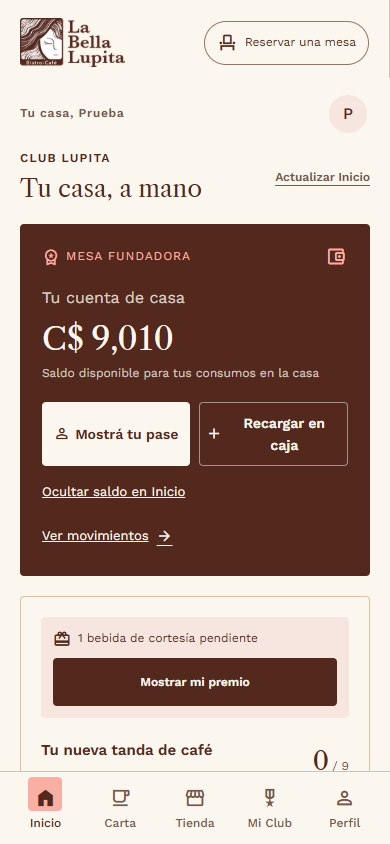
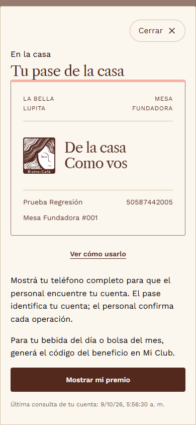
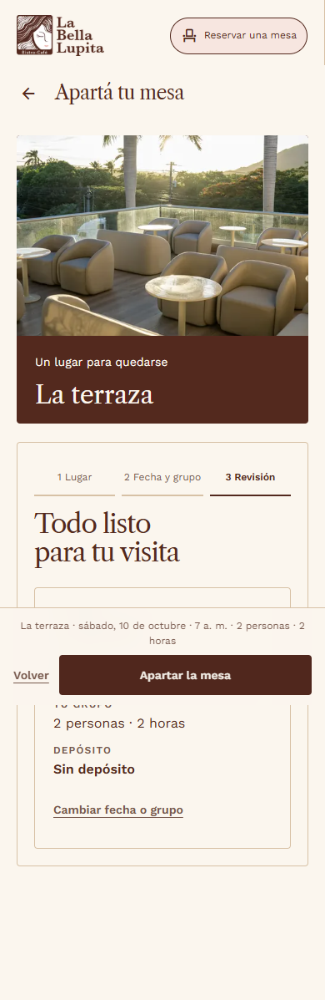

# Verificación UX premium

Capturas de la aplicación implementada con cuenta de prueba y API aislada.

- Cumpleaños sin desfase de fecha
- Premio pendiente accesible
- Cancelación de renovación reflejada en pantalla
- Respuesta perdida y recarga de página: una sola compra
- Sin desbordamiento horizontal en móvil y escritorio
- Pase reversible con movimiento y alternativa reducida
- Panel: cierre visible, Escape y retorno del foco
- Navegación conserva el inicio de la pantalla
- Carta sin marcadores repetidos, foto real y pedido funcional
- Reserva guiada preserva selección y confirma con API aislada
- Accesibilidad WCAG automatizada: Inicio, Carta, Tienda y Reserva
- Premium sin desbordamiento a 320, 390 y 1440 px
- Cierre de sesión sin conexión elimina los datos visibles
- Respuesta inválida muestra error recuperable
- Sin errores JavaScript

Build y guardián correctos. Los doce grupos de regresión de negocio pasan.

